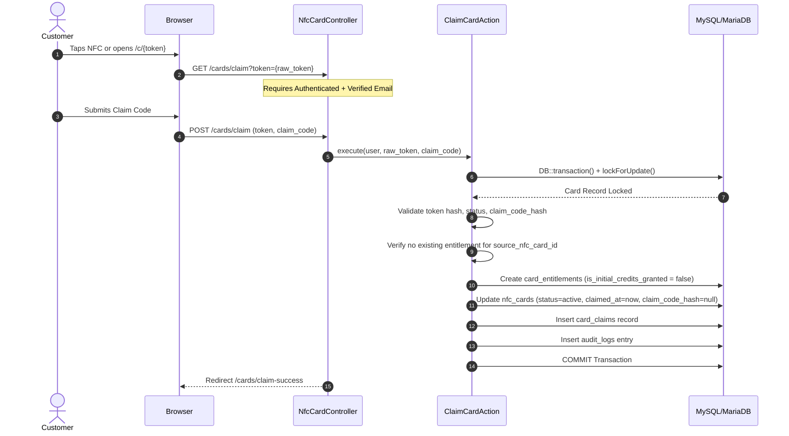

# AURA CARD — NFC Hardware Lifecycle & Anti-Fraud Engine

## 1. Executive Summary & Hardware Separation Model

AURA CARD bridges physical high-finish NFC business cards with digital professional SaaS profiles. A fundamental security tenet of the platform is that **the physical NFC chip contains ONLY an HTTPS URL**:

```
https://DOMAIN/c/{RAW_PUBLIC_TOKEN}
```

> [!IMPORTANT]
> **No customer private data is ever stored on the physical NFC chip.**
> The web platform generates the unique URL and operational export.
> **Actual physical chip writing remains an external physical action**:
> 1. AURA CARD system generates NFC Card record and export URL.
> 2. Operator writes URL to NTAG213/215/216 NFC chip via hardware programmer or mobile NFC writer.
> 3. Operator tests physical tap before distribution.
> The server does NOT write NFC tags remotely.

---

## 2. Cryptographic Token Architecture

### 2.1 Non-Enumerable Public URL Token
- Each physical card is provisioned with a cryptographically secure 64-character hex token (`bin2hex(random_bytes(32))`).
- **Database Storage**: The database **NEVER** stores the raw public token. Only `SHA-256(raw_token)` is indexed (`public_token_hash`).
- **Lookup Flow**:
  1. Smartphone taps physical NFC chip → browser issues `GET /c/{raw_token}`.
  2. Server validates 64-character hexadecimal format.
  3. Server computes `hash('sha256', $raw_token)`.
  4. Server performs an indexed lookup against `nfc_cards.public_token_hash`.
  5. If not found, a generic safe 404 is returned to prevent enumeration.

### 2.2 Ephemeral Export & Programming Artifacts
- The raw public URL is exposed **only once** at creation/batch export time in-memory via `GeneratedCardResult` DTO.
- It is never logged in Laravel logs, database audit logs, or error messages.
- If physical card reprogramming is required, an authorized Admin can trigger `RotateCardTokenAction`, which mints a new token and requires physical tag rewriting.

---

## 3. One-Time Claim Codes

- Each card is assigned an activation claim code (e.g. `AURA-XXXX-XXXX`) generated with high entropy (`random_bytes`).
- **Storage**: Stored strictly as a bcrypt/argon2 hash (`claim_code_hash`) via Laravel `Hash::make()`.
- **Destruction**: Immediately upon successful claim in `ClaimCardAction`, `claim_code_hash` is permanently set to `NULL`.
- A consumed claim code can **never** be used again.

---

## 4. Physical Card Entitlement Model (`card_entitlements`)

AURA CARD implements the invariant:
$$\text{ONE ELIGIBLE PHYSICAL PURCHASE} = \text{ONE FREE ENTITLEMENT}$$

### 4.1 Entitlement Structure
- `id`: ULID
- `source_nfc_card_id`: The immutable identifier of the original purchased card.
- `current_nfc_card_id`: The active physical card (changes only upon authorized card replacement).
- `user_id`: Owning customer.
- `profile_id`: Linked digital profile (nullable, populated in Phase 3/4).
- `initial_credits_amount`: Default `2`.
- `is_initial_credits_granted`: Default `false`.
- `status`: `active`, `transferred`, `revoked`.

### 4.2 Critical Anti-Fraud Rule: Zero Credits at Claim Time
> [!CAUTION]
> **CLAIMING A CARD DOES NOT GRANT +2 EDIT CREDITS.**
> Card claiming solely creates the eligible `card_entitlement` record with:
> `is_initial_credits_granted = false`
> 
> The 2 free profile modification credits are credited to the customer ledger **strictly upon the first successful digital profile publication** (Phase 3/4). No credit ledger transactions occur during Phase 2.

---

## 5. Card Status State Machine

Every card implements the canonical typed `CardStatus` enum:

| Status | Resolves Publicly? | Behavior on `GET /c/{token}` | Notes |
|---|---|---|---|
| `inventory` | No | Prompts claim/activation | Card manufactured, unassigned |
| `reserved` | No | Prompts claim/activation | Reserved for customer or batch dispatch |
| `sold` | No | Prompts claim/activation | Dispatched to buyer, awaiting tap |
| `unclaimed` | No | Prompts claim/activation | Ready for customer claiming |
| `claimed` | Yes | Directs to customer profile | Claimed by owner |
| `active` | Yes | Directs to customer profile | Fully active |
| `suspended` | No | Renders professional "Card Suspended" screen | Owner or Admin paused card |
| `lost` | No | Renders safe "Card Inactive" screen | Reported lost by owner |
| `replaced` | No | Inactive / redirected per policy | Old hardware retired |
| `disabled` | No | Renders safe "Card Inactive" screen | Terminated by Admin |

---

## 6. Atomic Card Claim Flow (`ClaimCardAction`)



### Double-Claim Protection
- Database unique constraint on `card_entitlements.current_nfc_card_id`.
- `DB::transaction()` with pessimistic `lockForUpdate()` on the card row.
- Zero possibility of simultaneous tap race conditions claiming the same card twice.

---

## 7. Card Replacement (`ReplaceCardAction`)

When a customer loses Card A (`AC-000001`) and is issued replacement Card B (`AC-000999`):
1. Card A status is set to `replaced`.
2. Card B status is set to `active`, linked to customer.
3. In `card_entitlements`:
   - `source_nfc_card_id` remains Card A (immutable).
   - `current_nfc_card_id` transitions from Card A to Card B.
   - `is_initial_credits_granted` remains unchanged.
   - **Zero new entitlements or credits are generated.**
4. A permanent immutable record is written to `card_transfers` (`transfer_type = replacement`).

---

## 8. Privacy & Anti-Abuse (`PrivacyIdentifierService`)

To comply with strict privacy regulations while preventing card enumeration attacks:
- Raw IP addresses are **never** stored permanently in claims or telemetry.
- An ephemeral daily salted HMAC is derived:
  $$\text{Identifier} = \text{HMAC-SHA256}(\text{IP} + \text{DailySalt}, \text{APP\_KEY})$$
- Daily rotation ensures visitor tap activity cannot be linked across multiple days.
